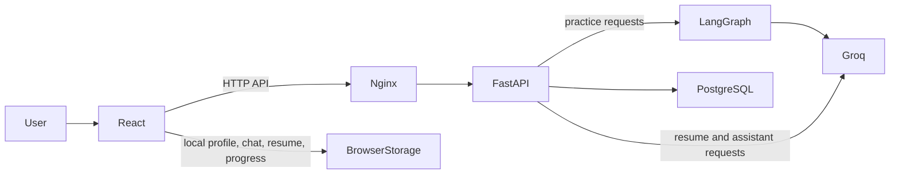

# CareerForge

CareerForge is an AI-assisted interview preparation and resume coaching
application. It combines a React web client with a FastAPI backend, PostgreSQL,
LangGraph, and Groq.

## Contents

- [Features](#features)
- [Technology](#technology)
- [Architecture](#architecture)
- [Getting started](#getting-started)
- [Local development](#local-development)
- [Configuration](#configuration)
- [Routes and API](#routes-and-api)
- [Testing](#testing)
- [Security and privacy](#security-and-privacy)
- [Contributing](#contributing)
- [Known limitations](#known-limitations)
- [License](#license)

## Features

- AI coaching for DSA, SQL, technical interviews, and behavioral/HR practice.
- Separate protected pages for Overview, Practice, Mock Interviews, Resume
  Review, and Progress.
- Account registration, login, JWT session restoration, profile editing, and
  logout.
- PDF, DOCX, and TXT resume upload and text extraction.
- Resume feedback tailored to a target role.
- Improved resume generation with a preview, editable LaTeX source, `.tex`
  download, and PDF export.
- Markdown-formatted AI responses, browser-based practice history, and progress
  tracking.
- Responsive blue CareerForge theme with dark appearance support.

## Technology

| Area | Technologies |
|---|---|
| Frontend | React 18, Vite, React Router, React Markdown |
| Backend | Python 3.12, FastAPI, Pydantic, SQLAlchemy |
| AI | Groq, LangChain, LangGraph |
| Database | PostgreSQL |
| Deployment | Docker Compose, Nginx |

## Architecture



The LangGraph supervisor routes practice prompts to DSA, SQL, technical, or HR
agents. Resume analysis and generation use the configured Groq model directly.
PostgreSQL stores user accounts and profiles; browser storage keeps practice
activity, chat history, theme, and resume text on the current device.

## Getting started

### Prerequisites

- Docker Desktop with Docker Compose v2.
- A Groq API key for AI coaching and resume features.

### 1. Clone the repository

```bash
git clone https://github.com/Anuragluckshetty/GEN-AI-PROJECT.git
cd GEN-AI-PROJECT
```

### 2. Configure the environment

Create the backend environment file:

```powershell
Copy-Item backend/.env.example backend/.env
```

On macOS or Linux:

```bash
cp backend/.env.example backend/.env
```

Edit `backend/.env` and set `GROQ_API_KEY`. For Docker Compose, also create a
`.env` file beside `docker-compose.yml` and set a strong JWT signing secret:

```dotenv
JWT_SECRET_KEY=replace-with-a-long-random-secret
```

The root `.env` supplies Compose-level settings. Do not commit either `.env`
file.

### 3. Start the application

```bash
docker compose up --build -d
docker compose ps
```

Open:

- Frontend: <http://localhost:5173>
- Backend API: <http://localhost:8000>
- Interactive API documentation: <http://localhost:8000/docs>
- Health check: <http://localhost:8000/health>

Stop the services with `docker compose down`. To also delete the local
PostgreSQL data volume, use `docker compose down -v`.

## Local development

Docker Compose can start PostgreSQL while the frontend and backend run directly
on the host:

```bash
docker compose up -d postgres
```

### Backend

The backend reads `.env` from its current working directory.

```powershell
Set-Location backend
python -m venv .venv
.\.venv\Scripts\Activate.ps1
python -m pip install -r requirements.txt
python -m uvicorn app.main:app --reload
```

### Frontend

In a second terminal:

```powershell
Set-Location frontend
npm ci
$env:VITE_API_URL = "http://localhost:8000"
npm run dev
```

The default backend CORS configuration allows the Vite development origin at
`http://localhost:5173`.

## Configuration

| Variable | Purpose |
|---|---|
| `GROQ_API_KEY` | Groq credential for AI features; required to generate AI responses. |
| `GROQ_MODEL` | Groq model name; defaults to `openai/gpt-oss-20b`. |
| `DATABASE_URL` | SQLAlchemy database connection string. |
| `JWT_SECRET_KEY` | Secret used to sign access tokens; set a strong value outside development. |
| `ACCESS_TOKEN_EXPIRE_MINUTES` | JWT lifetime in minutes; defaults to `60`. |
| `BACKEND_CORS_ORIGINS` | Comma-separated allowed browser origins. |
| `MAX_UPLOAD_SIZE_MB` | Maximum resume upload size; defaults to `10`. |
| `VITE_API_URL` | Optional frontend API base URL; set for local or remote backend development. |

See [`backend/.env.example`](./backend/.env.example) for the backend template.

## Routes and API

| Route | Description | Access |
|---|---|---|
| `/login` | Sign in | Public |
| `/register` | Create an account | Public |
| `/overview` | Dashboard | Protected |
| `/practice` | Practice tracks and AI coach | Protected |
| `/mock-interviews` | Mock interview activities | Protected |
| `/resume-review` | Resume review and generation | Protected |
| `/progress` | Preparation progress | Protected |

The API is versioned under `/api/v1`.

| Method | Endpoint | Purpose |
|---|---|---|
| `GET` | `/health` | Health check |
| `GET` | `/api/v1/agents` | List available agents |
| `POST` | `/api/v1/practice/ask` | Submit a routed practice prompt |
| `POST` | `/api/v1/assistant/chat` | General assistant chat |
| `POST` | `/api/v1/assistant/resume/upload` | Extract text from an uploaded resume |
| `POST` | `/api/v1/assistant/resume/chat` | Ask for resume feedback |
| `POST` | `/api/v1/assistant/resume/generate` | Generate structured resume content and LaTeX |
| `POST` | `/api/v1/auth/register` | Register a user |
| `POST` | `/api/v1/auth/login` | Authenticate and obtain a JWT |
| `GET` | `/api/v1/auth/me` | Get the authenticated user |
| `PUT` | `/api/v1/auth/profile` | Update the authenticated profile |

The full interactive API reference is available at `/docs` when the backend is
running.

## Testing

Run the backend tests from the repository root:

```bash
python -m pytest backend/tests -q
```

Build the frontend:

```bash
cd frontend
npm ci
npm run build
```

## Security and privacy

- Never commit API keys, passwords, production database credentials, or `.env`
  files. Keep secrets in local environment files or deployment secret stores.
- Passwords are hashed by the backend; authentication uses signed JWT access
  tokens.
- Resume text is sent to the configured Groq service when AI resume features
  are used. Resume text and practice activity are also stored in browser
  storage on the current device.
- Do not upload sensitive personal information unless you are comfortable
  sending it to the configured AI provider.

## Contributing

Contributions are welcome. Before opening a pull request:

1. Create a focused branch from `main`.
2. Keep changes scoped and update relevant documentation.
3. Run the backend tests and frontend production build.
4. Describe the change and include reproduction or validation steps.

## Known limitations

- Practice history, chat history, theme, and resume text use browser storage;
  they do not sync across devices.
- The `backend/app/rag` package is a placeholder. Embedded-document retrieval
  is not currently implemented.

## License

This repository does not currently include a license file. If you intend to
distribute CareerForge as open-source software, add a license that reflects
your intended reuse and distribution terms.
